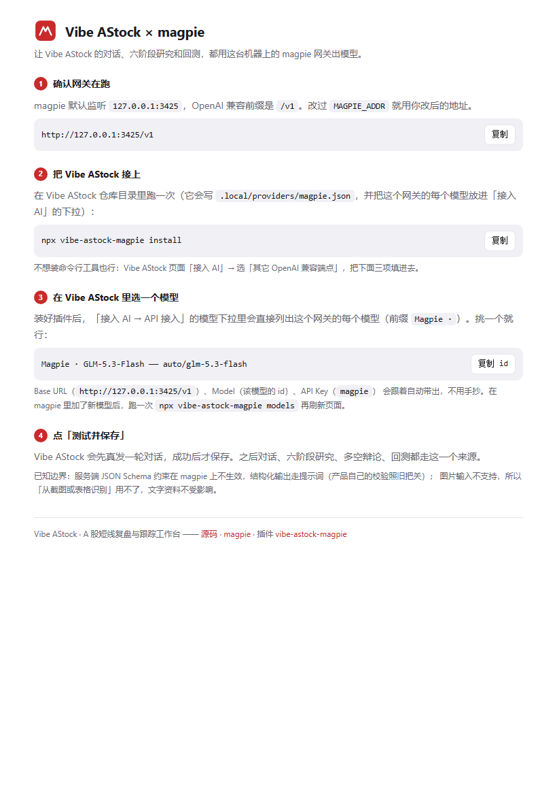

# vibe-astock-magpie

Connect a local [magpie](https://github.com/yetone/magpie) gateway to
[Vibe AStock](https://github.com/simonlin1212/vibe-astock).

Once installed, Vibe AStock's *Connect AI* picker lists every model the gateway offers. Pick one, hit *Test and save* —
no URL, model name or key to type.


## Requirements

- Node.js ≥ 22.18
- Vibe AStock v2.1.x from source (the portable build ships a prebuilt `desktop/dist`, which cannot take the patch)
- magpie running, default `127.0.0.1:3425`

## Install

```sh
npx vibe-astock-magpie install                        # inside the Vibe AStock checkout
npx vibe-astock-magpie install --repo /path/to/vibe-astock
npx vibe-astock-magpie install --repo /path/to/vibe-astock --no-ui   # template only
```

Before the npm release: `node bin/cli.mjs install --repo <path>` from a clone.

The installer writes `<repo>/.local/providers/magpie.json` (default model: a magpie `auto/*` routing group) and inserts the
gateway's current model list into `ai-models.ts`. A gateway that is not running is fine — the default model stays empty.

Restart Vibe AStock, then: **Connect AI → API → pick a `Magpie · …` entry → Test and save.** Base URL, model id and the
API key come along.

After adding a provider or routing group in magpie, run `vibe-astock-magpie models` and reload. The picker is a
compile-time constant; nothing is fetched at runtime.

Without the tool: *Connect AI → Other OpenAI-compatible endpoint* with `http://127.0.0.1:3425/v1`, a model id, and the key
`magpie`.

## Commands

```
install    template + model list + patches (idempotent)
models     refresh the model list only
uninstall  remove the template and every patch
verify     run Vibe AStock's own capability matrix; --write stores the result
doctor     check repo, template, gateway, model count, patch state
```

Shared options: `--repo`, `--data-root`, `--dry-run`. `verify` also takes `--tests`, `--model`, `--write`.

Exit codes: 0 done (including "gateway not running"), 2 precondition missing, 1 unexpected error.

## Measured

2026-11-13, `auto/glm-5.3-flash`, Vibe AStock v2.1.6 — 8 of 10:

| # | Case | Result |
|---|---|---|
| 1 | single text turn | pass |
| 2 | one tool call | pass |
| 3 | three chained tool calls | pass |
| 4 | parallel tool calls | pass |
| 5 | recovery after a failing tool | pass |
| 6 | long output | pass |
| 7 | tool-free JSON closing turn | pass |
| 8 | server-side JSON Schema | fail — structured output falls back to the prompt |
| 9 | multi-turn context | pass |
| 10 | image input | timeout after 180 s |

Other models may differ; rerun `verify --write`.

## What it touches

- `<dataRoot>/providers/magpie.json` — a provider template, which the product already supports
- `desktop/src/verticals/finance/lib/ai-models.ts` — the model list between `// magpie-plugin:begin/end`
- `ai-models.ts`, `aiConnection.ts`, `Settings.tsx` — one marked line each (type, base URL, preset name, source label, key prefill)

Patches are idempotent and skipped when an anchor is gone; after `uninstall`, `git status` shows only your own changes. The
template stores an environment variable name (`MAGPIE_API_KEY`), never a key — the prefilled `magpie` is the gateway's local
literal, handled by the product's own localStorage path.

## Limits

- The picker does not follow magpie by itself — run `models` after adding models
- No image input on this line
- No server-side JSON Schema; the product's validators still check every artifact
- A remote magpie needs an https hostname (only `https` and `localhost / 127.0.0.1 / [::1]` are allowed)

## The magpie page plugin

`magpie-page/` is a page for magpie's Plugins tab: it shows what to paste, with copy buttons.



```sh
magpie plugin add ./magpie-page
magpie plugin add @lee-lipeng/page-vibe-astock   # once published
```

## Development

```sh
npm test                                              # 16 tests, no gateway needed
node bin/cli.mjs doctor --repo /path/to/vibe-astock
node bin/cli.mjs install --repo /path/to/vibe-astock --dry-run
```

Publishing steps: [PUBLISH.md](PUBLISH.md).

## License

MIT. Not affiliated with Vibe AStock (Apache-2.0) or magpie (MIT).
