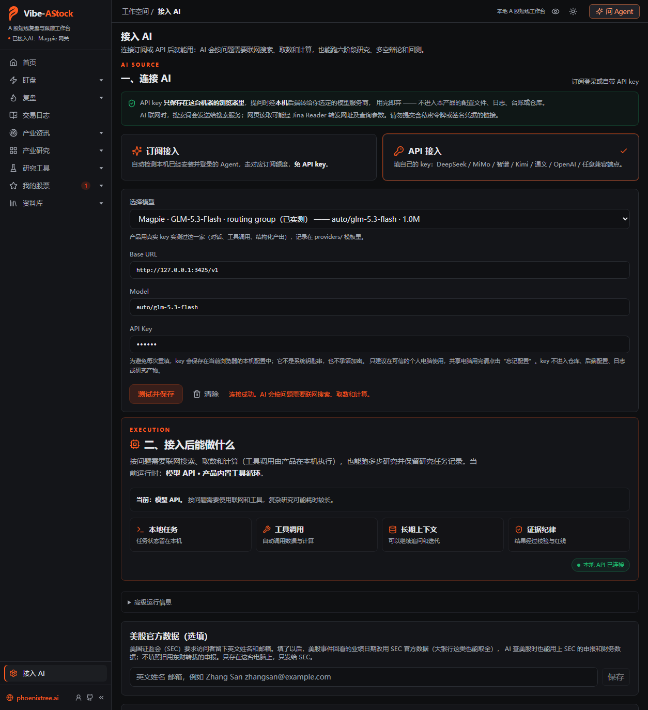

# vibe-astock-magpie

Connect a local [magpie](https://github.com/yetone/magpie) gateway to
[Vibe AStock](https://github.com/simonlin1212/vibe-astock) — an A-share short-line review workbench.

After installing, Vibe AStock's *Connect AI* picker lists **every model the gateway offers**: choose one, hit
*Test and save*, done. No URL, no model name, no key to type.



Vibe AStock v2 speaks **OpenAI-compatible Chat Completions** only (`POST {base_url}/chat/completions`), and magpie serves
exactly that at `http://127.0.0.1:3425/v1` — so the two fit together without touching product code.

## Requirements

| Item | Requirement |
|---|---|
| Node.js | ≥ 22.18 (native `fetch`, `node --test`) |
| Vibe AStock | v2.1.x **from source** (tested on v2.1.6); the portable build ships a prebuilt `desktop/dist` and cannot take the picker patch |
| magpie | running, default `127.0.0.1:3425` (`MAGPIE_ADDR` changes it) |
| OS | Windows, macOS or Linux — the scripts use Node's standard library only |

## Install

```sh
# inside the Vibe AStock checkout
npx vibe-astock-magpie install

# or point at it from anywhere
npx vibe-astock-magpie install --repo /path/to/vibe-astock

# template only, leave the frontend alone
npx vibe-astock-magpie install --repo /path/to/vibe-astock --no-ui
```

Before the npm release, run it from source: `node bin/cli.mjs install --repo <path>`.

The installer:

1. probes `http://127.0.0.1:3425/v1/models` and writes `<repo>/.local/providers/magpie.json` with a working default model
   (prefers magpie's `auto/*` routing groups). A gateway that is not running is not fatal — the model is just left empty;
2. renders **every model the gateway offers** into the picker as one marked block, plus five one-line patches
   (type, base URL, source label, key prefill), each marked `// magpie-plugin`.

Then restart Vibe AStock and pick a model: **Connect AI → API → any `Magpie · …` entry → Test and save.**
Base URL, model id and the API key (`magpie`, the gateway's local default) come along.

> After adding a provider or routing group in magpie, run `vibe-astock-magpie models` and reload the page — the picker is
> a compile-time constant and nothing is fetched at runtime. `doctor` tells you when it is out of date.

Without the tool, the stock UI still works: *Connect AI → Other OpenAI-compatible endpoint* with
`http://127.0.0.1:3425/v1`, a model id from `/v1/models`, and the key `magpie`.

## Commands

```
vibe-astock-magpie install     [--repo DIR] [--base-url URL] [--model ID] [--key KEY] [--no-ui] [--force] [--dry-run]
vibe-astock-magpie models      [--repo DIR] [--base-url URL] [--key KEY] [--dry-run]
vibe-astock-magpie uninstall   [--repo DIR] [--dry-run]
vibe-astock-magpie verify      [--repo DIR] [--tests 1,2,7,8] [--model ID] [--write]
vibe-astock-magpie doctor      [--repo DIR]
```

`verify` reuses Vibe AStock's own provider matrix (`orchestrator/src/finance/provider_matrix.ts`): ten small rounds covering
text, single/chained/parallel tool calls, tool-error recovery, long output, a tool-free JSON closing turn, server-side JSON
Schema, multi-turn context and image input. Results land in `.local/provider-matrix/magpie/<time>/`; `--write` copies the
suggested `direct` block into the data-root template only.

Exit codes: `0` done (including "gateway not running", which degrades), `2` precondition missing, `1` unexpected error.

## Measured

2026-11-13, model `auto/glm-5.3-flash`, Vibe AStock v2.1.6: **8 pass, 1 fail, 1 timeout**.

Everything the six-stage research loop needs — tool calls, chaining, parallel calls, error recovery, long output,
multi-turn — passes. Server-side JSON Schema is not enforced by this model, so structured output falls back to prompt mode
(the product's own validators still check every artifact). Image input timed out, so image-based material import is out.

## How it works

Vibe AStock already accepts any provider template dropped into its data root (`<dataRoot>/providers/<id>.json`, which wins
over the bundled ones), but the *Connect AI* picker is a compile-time constant with no dynamic source. So:

| Change | Where | Shape |
|---|---|---|
| provider template | `<dataRoot>/providers/magpie.json` | an extension point the product already has |
| model list | `desktop/src/.../lib/ai-models.ts` | one block between two markers: replaced on refresh, deleted on uninstall |
| type, base URL, preset name, source label, key prefill (five lines) | `ai-models.ts`, `aiConnection.ts`, `Settings.tsx` | one line each, marked `// magpie-plugin` |

Every patch is idempotent and reversible; when an anchor is missing (upstream changed the file) it is skipped and reported
instead of guessing.

**Why not fetch at runtime**: the gateway sends no CORS headers and answers `OPTIONS` with 404, so `fetch('/v1/models')`
from a page is always blocked. Getting around that means patching the Vite proxy or the backend — not worth it to save one
`models` command.

## Safety

- The plugin collects nothing and reports nothing; its only network call goes to `127.0.0.1:3425`.
- The template stores an **environment variable name** (`MAGPIE_API_KEY`), never a key. The prefilled `magpie` is magpie's
  local literal, kept in the browser's localStorage exactly like a typed key.
- Upstream vendor keys and subscription logins stay inside magpie; Vibe AStock only talks to the gateway.
- `uninstall` restores every touched file byte for byte (covered by tests).

## Known limits

- The picker does not follow magpie by itself — run `models` after adding models.
- No image input on this line (timeout).
- No server-side JSON Schema; structured output falls back to prompt mode.
- The portable build (prebuilt `desktop/dist`) cannot take the patch unless you `npm run build` again.
- A remote magpie needs https: Vibe AStock only allows `https` and `localhost / 127.0.0.1 / [::1]`.

## Layout

```
provider.json          provider template (generic, default_model left empty)
bin/cli.mjs            install / models / uninstall / verify / doctor
lib/install.mjs        repo + data-root detection, template IO, gateway probe
lib/models.mjs         gateway catalogue -> picker entries
lib/patch.mjs          model block + five one-line patches
test/patch.test.mjs    16 pure-function tests
magpie-page/           a page plugin for magpie's Plugins tab
docs/                  screenshots used by this README
PUBLISH.md             how to publish to npm / GitHub / the magpie registry
```

## Development

```sh
npm test                          # 16 tests, no gateway needed
node bin/cli.mjs doctor --repo /path/to/vibe-astock
node bin/cli.mjs install --repo /path/to/vibe-astock --dry-run
```

## FAQ

**Not port 3425?** magpie listens where `MAGPIE_ADDR` says; pass `--base-url`.

**magpie on another machine?** Give it an https hostname (Tailscale Serve, Caddy); Vibe AStock rejects plain http to a LAN IP.

**Which key?** magpie's own local key — the literal `magpie` by default. Vendor keys live in magpie.

**`git pull` lost the picker entry?** Upstream overwrote the patched file; run `install` again (idempotent).

**Does uninstall leave anything?** No: template removed, marker lines and the block deleted, `git status` back to your own changes.

## License

MIT. Not affiliated with [Vibe AStock](https://github.com/simonlin1212/vibe-astock) (Apache-2.0) or
[magpie](https://github.com/yetone/magpie) (MIT).
