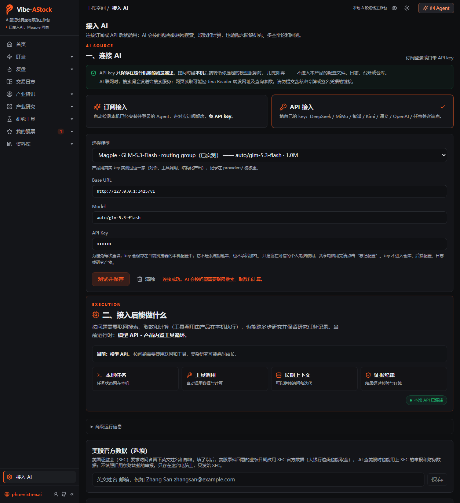
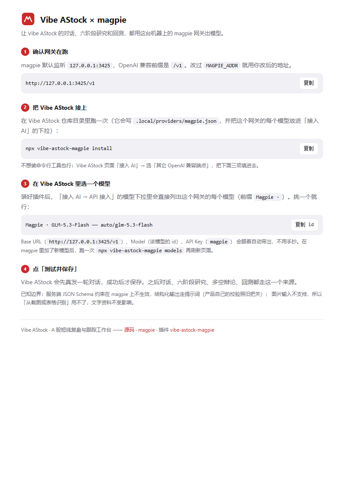

# vibe-astock-magpie

把 [magpie](https://github.com/yetone/magpie) 本地网关接进 [Vibe AStock](https://github.com/simonlin1212/vibe-astock)。

装完后「接入 AI」下拉里直接列出网关的每个模型，选一个、点「测试并保存」就行，不用填 URL、模型名和 key。



## 要求

- Node.js ≥ 22.18
- Vibe AStock v2.1.x 源码安装（免安装包的 `desktop/dist` 是打包好的页面，用不了补丁）
- magpie 在跑，默认 `127.0.0.1:3425`

## 安装

```sh
npx vibe-astock-magpie install                          # 在 Vibe AStock 仓库目录里
npx vibe-astock-magpie install --repo /path/to/vibe-astock
npx vibe-astock-magpie install --repo /path/to/vibe-astock --no-ui   # 只装模板
```

还没发到 npm 时，克隆本仓库后 `node bin/cli.mjs install --repo <Vibe AStock 路径>`。

安装器做两件事：写 `<仓库>/.local/providers/magpie.json`（默认模型取网关的 `auto/*` 路由组），把网关当前的模型清单插进 `ai-models.ts`。网关没开也能装，默认模型留空。

重启产品，然后：**接入 AI → API 接入 → 选一个 `Magpie · …` → 测试并保存**。Base URL、Model、API Key 会跟着带出来。

在 magpie 里加了 provider 或路由组之后，跑一次 `vibe-astock-magpie models` 再刷新页面。下拉是编译期常量，运行时不发请求。

不装插件也行：接入 AI 里选「其它 OpenAI 兼容端点」，填 `http://127.0.0.1:3425/v1`、一个模型 id、key `magpie`。

## 命令

```
install    写模板 + 刷新下拉清单 + 打补丁（幂等）
models     只刷新下拉里的模型清单
uninstall  删模板、摘掉所有补丁
verify     用 Vibe AStock 自己的兼容矩阵实测这条线，--write 写回 direct 段
doctor     检查仓库、模板、网关、模型条数、补丁状态
```

通用选项：`--repo`、`--data-root`、`--dry-run`。`verify` 另有 `--tests`、`--model`、`--write`。

退出码：0 正常（含网关没启动），2 前置条件不满足，1 未预期错误。

## 实测

2026-11-13，`auto/glm-5.3-flash`，Vibe AStock v2.1.6，10 项里 8 通过：

| # | 项目 | 结果 |
|---|---|---|
| 1 | 单次文本 | 通过 |
| 2 | 单工具调用 | 通过 |
| 3 | 连续三轮工具调用 | 通过 |
| 4 | 并行工具调用 | 通过 |
| 5 | 工具失败自修复 | 通过 |
| 6 | 长输出 | 通过 |
| 7 | 工具后分轮收尾 | 通过 |
| 8 | 服务端 JSON Schema | 不通过，结构化输出走提示词 |
| 9 | 多轮上下文 | 通过 |
| 10 | 图片输入 | 超时 180 秒 |

换别的模型结论可能不同，重跑 `verify --write` 即可。

## 它改了什么

- `<数据根>/providers/magpie.json`：provider 模板，产品本来就支持数据根里的模板
- `desktop/src/verticals/finance/lib/ai-models.ts`：一对 `// magpie-plugin:begin/end` 之间的模型清单
- `ai-models.ts`、`aiConnection.ts`、`Settings.tsx`：各一行标记补丁（类型、Base URL、预设名、来源名、key 预填）

补丁幂等，锚点找不到就跳过，`uninstall` 之后 `git status` 只剩你自己的改动。模板里只存环境变量名 `MAGPIE_API_KEY`，不存 key；预填的 `magpie` 是网关的本地字面量，走产品原有的 localStorage。

## 限制

- 下拉不会跟着 magpie 自动变，加模型后跑 `models`
- 图片输入超时，「从截图或表格识别」用不了
- 服务端 JSON Schema 不生效，靠产品自己的校验兜底
- 远程 magpie 需要 https 域名（只放行 `https` 与 `localhost / 127.0.0.1 / [::1]`）

## magpie 侧的页面

`magpie-page/` 是 magpie 的 page 插件，装进 Plugins 页后显示该填什么，一键复制。



```sh
magpie plugin add ./magpie-page        # 本地
magpie plugin add @lee-lipeng/page-vibe-astock   # 发布后
```

## 开发

```sh
npm test                                                # 16 项，不需要网关
node bin/cli.mjs doctor --repo /path/to/vibe-astock
node bin/cli.mjs install --repo /path/to/vibe-astock --dry-run
```

发布步骤见 [PUBLISH.md](PUBLISH.md)。

## 许可

MIT。与 Vibe AStock（Apache-2.0）、magpie（MIT）均无隶属关系。
